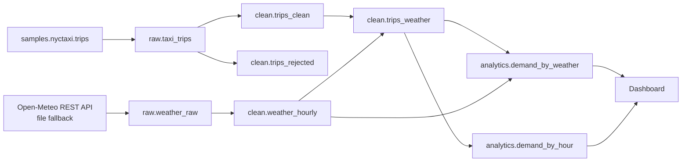
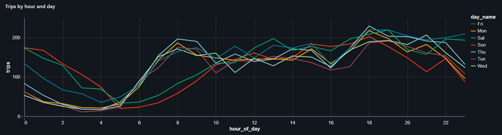

# NYC Taxi + Weather Pipeline on Databricks

Batch pipeline on Databricks Free Edition that joins NYC taxi trips (Jan-Feb 2016)
with hourly weather from the Open-Meteo REST API, in three layers: raw, clean, analytics.

## Architecture

| Layer | Schema | What it holds |
|-------|--------|---------------|
| Raw | `raw` | Data as received, plus `_ingested_at` and `_source` |
| Clean | `clean` | Validated trips, hourly weather, joined table, rejected rows |
| Analytics | `analytics` | Tables that answer specific questions |

## Design points

- **REST API with fallback:** weather is fetched from Open-Meteo with retry on 429 and 5xx errors.
  If the API is unavailable, the pipeline reads a saved copy from a Unity Catalog Volume.
  The `_source` column records which one was used.
- **Data quality:** 85 of 21,932 trips were rejected (distance <= 0, fare <= 0, dropoff not after pickup)
  and stored in `clean.trips_rejected` with a reason. Asserts check that no rows are lost
  between layers and that every trip matches a weather hour.
- **Timestamps:** the hourly trip distribution (low at 4-5 AM, peak at 6-7 PM) showed that trip times
  are already in New York local time, so no conversion was needed.
- **Orchestration:** a Databricks Job runs the three notebooks in order. Writes use overwrite, so reruns are safe.

## Findings

- On sub-freezing hours, snow had about 11.9 trips/hour versus 14.2 on dry hours (about 17% lower),
  with shorter trips and lower fares.
- Rain had a smaller effect, and some rain groups cover only 19-66 hours, so those differences are not conclusive.
- Demand is lowest around 4-5 AM and peaks around 6-7 PM. Midnight is much busier on weekends.

**Limits:** the dataset is a sample, so numbers show relative differences, not real volumes.
The analysis is descriptive, not causal.

## Notebooks

- `notebooks/01_raw_ingestion.ipynb`: taxi trips and weather into the raw layer
- `notebooks/02_clean.ipynb`: validation, hourly weather, join, rejected rows
- `notebooks/03_analytics.ipynb`: demand by weather and by hour

Stack: Databricks Free Edition, PySpark, SQL, Unity Catalog, Databricks Jobs, AI/BI dashboard.
