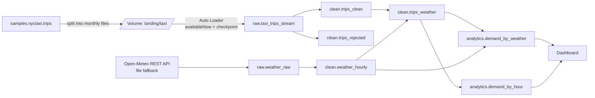
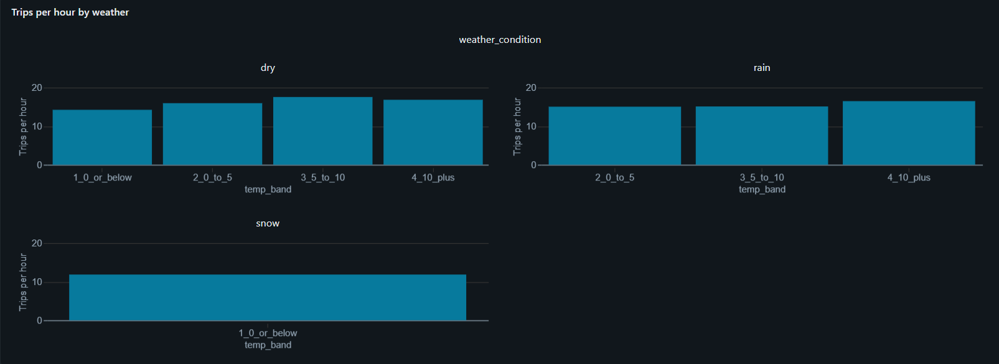

# NYC Taxi + Weather Pipeline on Databricks

Incremental batch pipeline on Databricks Free Edition. Taxi trips (NYC, Jan-Feb 2016) land as files
and are ingested with Auto Loader, then joined with hourly weather from the Open-Meteo REST API,
in three layers: raw, clean, analytics.

## Architecture

| Layer | Schema | What it holds |
|-------|--------|---------------|
| Raw | `raw` | Data as received, plus ingestion metadata (`_ingested_at`, `_source` / `_source_file`) |
| Clean | `clean` | Validated trips, hourly weather, joined table, rejected rows |
| Analytics | `analytics` | Tables that answer specific questions |

## Design points

- **Incremental ingestion with Auto Loader:** taxi data lands as files in a Unity Catalog Volume.
  Auto Loader (`cloudFiles`, `trigger(availableNow=True)`) tracks processed files in a checkpoint,
  so each run ingests only new files. Tested: after adding the February file, the job processed only
  that file, and re-running the job added 0 rows (the table stays at 21,932).
  The January/February split simulates files arriving over time.
- **REST API with fallback:** weather is fetched from Open-Meteo with retry on 429 and 5xx errors.
  If the API is unavailable, the pipeline reads a saved copy from a Unity Catalog Volume.
  The `_source` column records which one was used.
- **Data quality:** 85 of 21,932 trips were rejected (distance <= 0, fare <= 0, dropoff not after pickup)
  and stored in `clean.trips_rejected` with a reason. Asserts check that no rows are lost
  between layers and that every trip matches a weather hour.
- **Timestamps:** the hourly trip distribution (low at 4-5 AM, peak at 6-7 PM) showed that trip times
  are already in New York local time, so no conversion was needed.
- **Orchestration:** a Databricks Job with four tasks. `raw_weather` and `raw_taxi_autoloader` run in
  parallel, then `clean`, then `analytics`.

## Findings

- On sub-freezing hours, snow had about 11.9 trips/hour versus 14.2 on dry hours (about 17% lower),
  with shorter trips and lower fares.
- Rain had a smaller effect, and some rain groups cover only 19-66 hours, so those differences are not conclusive.
- Demand is lowest around 4-5 AM and peaks around 6-7 PM. Midnight is much busier on weekends.

## Limits

- The dataset is a sample, so numbers show relative differences, not real volumes.
  The analysis is descriptive, not causal.
- `clean` and `analytics` are full refresh on every run. That is fine at 22K rows;
  at scale I would switch to `MERGE` or Lakeflow Declarative Pipelines.
- Free Edition (serverless) does not support continuous streaming, so this is incremental batch, not real-time.
- Source data is a static sample, so the January/February file split is a simulation.

## How to run

1. Run `00_simulate_landing` once. It writes the January file to the landing folder and keeps
   February in a staging folder. It is **not** part of the Job (re-running it would create duplicate files).
2. Run the Job. On a new workspace, run `01_raw_ingestion` once first so the schemas exist.
3. To simulate a new file arriving, copy the February folder from staging to landing, then run the Job again.

## Notebooks

- `notebooks/00_simulate_landing.ipynb`: one-off setup, splits taxi data into monthly files
- `notebooks/01_raw_ingestion.ipynb`: creates schemas, fetches weather from the API into the raw layer
- `notebooks/01b_raw_autoloader.ipynb`: Auto Loader ingestion of taxi files into the raw layer
- `notebooks/02_clean.ipynb`: validation, hourly weather, join, rejected rows
- `notebooks/03_analytics.ipynb`: demand by weather and by hour

Stack: Databricks Free Edition, PySpark, SQL, Auto Loader, Unity Catalog, Delta Lake, Databricks Jobs, AI/BI dashboard.
